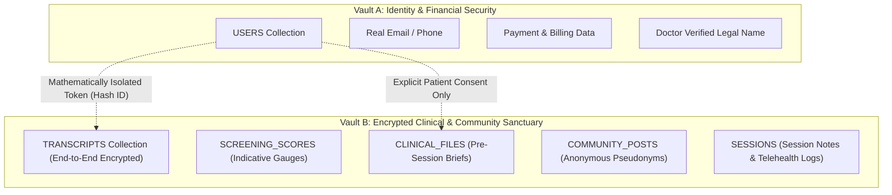
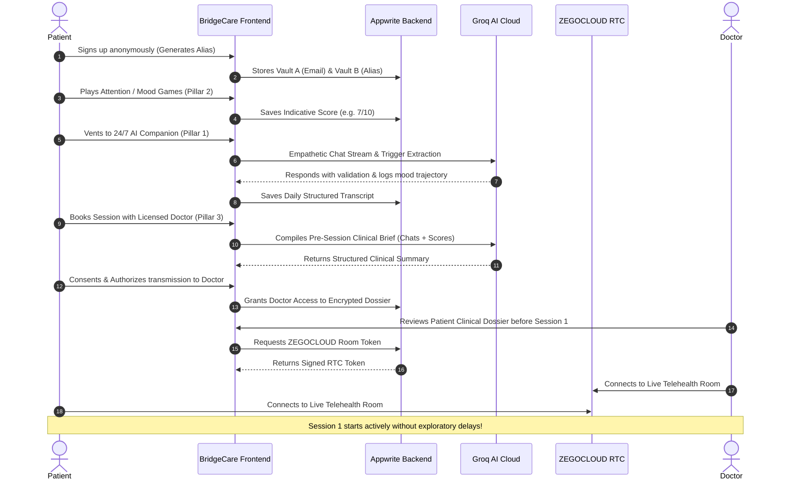

# BridgeCare — Master Architecture & Implementation Roadmap

> **Document Status**: Production Blueprint  
> **Target Audience**: AI Agents & Engineering Team  
> **Last Updated**: October 2026  
> **System Ecosystem**: Comprehensive Mental Health Support Ecosystem  

---

## 1. Executive Vision & System Overview

BridgeCare is an all-in-one, stigma-free mental health platform engineered to resolve the four systemic bottlenecks of traditional mental healthcare:
1. **Delayed & Difficult Diagnosis**: 45-minute exploratory visits take months to piece together a patient's daily context.
2. **High Financial Burden**: Patients waste \$300–\$600 on 3 to 5 initial exploratory sessions before real treatment begins.
3. **Loss of Context Over Time**: By Session 7 or 8, patients forget daily events and triggers; doctors cannot recall longitudinal nuances across dozens of patients.
4. **Social Stigma & Embarrassment**: Patients fear clinical questionnaires and hide critical symptoms.

BridgeCare solves this through **4 Core Pillars**:
- **Pillar 1**: 24/7 AI Daily Venting Companion & Automated Longitudinal Transcripts (powered by **Groq**).
- **Pillar 2**: Comprehensive Gamified Symptom Screening (Attention/ADHD, Mood/Bipolar/Anxiety, Pattern/OCD) generating $X/10$ Indicative Scales with strict Medical Disclaimers.
- **Pillar 3**: Therapist Integration & Ready Pre-Session Clinical File with HD Telehealth Video Consultations (powered by **ZEGOCLOUD**).
- **Pillar 4**: Safe & Anonymous Peer Community with Real-Time AI Safety Moderation (powered by **Groq**).

---

## 2. Technology Stack & Current Repository State

```
d:\BridgeCare\
├── apps\
│   └── Main\                         # Vite + React 18/19 SPA with TypeScript
│       ├── src\
│       │   ├── components\           # Reusable UI (PortalLayout, CrisisHotlineModal, ui/scroll-area)
│       │   ├── lib\                  # Utilities & Cookie management
│       │   ├── Pages\
│       │   │   ├── Auth\             # Login, Register wizard, ForgotPassword, VerifyEmail
│       │   │   ├── Portal\           # 13 Core portal pages (AiChat, AiReports, MentalDetectorGames, etc.)
│       │   │   └── Dashboard.tsx     # Patient Central Dashboard ("My Sanctuary")
│       │   ├── services\             # authService.ts, bynaraService.ts -> migrating to groqService.ts
│       │   └── i18n\                 # Full English & Arabic (RTL) localization
├── appwrite\
│   ├── appwrite.json                 # Project configuration, database tables, and cloud functions
│   └── functions\                    # Serverless microservices (Node.js 18+)
├── packages\                         # Turborepo shared packages
│   ├── UI-components\                # Shared design system components
│   ├── react-appwrite\               # Appwrite hooks, contexts & auth state
│   ├── Assets\                       # Logos, brand badges, SVGs
│   └── Utils-shared\                 # Common formatters & cryptographic helpers
└── docs\                             # Architectural implementation blueprints
```

### Core Technologies
- **Frontend**: Vite 5, React, TypeScript, Chakra UI v3 (Ark UI primitives, Panda CSS styling).
- **Backend & Auth**: Appwrite Cloud (`https://fra.cloud.appwrite.io/v1`, Project ID: `6adaf3cd000458c04102`).
- **AI Engine**: **Groq Cloud API** (high-speed inference with `llama-3.3-70b-versatile` / `mixtral-8x7b-32768`).
- **Telehealth Video/Audio**: **ZEGOCLOUD** Web RTC SDK / UI-Kit.
- **Localization**: `i18next` with complete English (`en`) and Arabic (`ar`, RTL) parity.

---

## 3. Dual-Vault Security Architecture

To guarantee absolute confidentiality, BridgeCare physically and logically separates patient identity from clinical logs:



- **Vault A**: Holds KYC, legal names, email OTPs, subscription billing. Accessible strictly by patient user ID.
- **Vault B**: Holds all daily venting logs, extracted triggers, game metrics, and community pseudonyms. **Zero personal names or emails exist in Vault B.**
- **Doctor Sharing**: A patient grants explicit, time-bounded permission for an assigned doctor to decrypt their Pre-Session Clinical File ahead of an appointment. The patient can revoke access at any time with 1 click.

---

## 4. Master Appwrite Database Schema (Database ID: `main`)

| Collection ID | Purpose | Security / Permissions | Key Attributes |
| :--- | :--- | :--- | :--- |
| `USERS` | Identity Vault A | `Role.user(userId)` Read/Update | `userId`, `userName`, `email`, `phoneNumber`, `age`, `country`, `role` (`patient` \| `therapist`), `anonymousAlias`, `avatarId` |
| `TRANSCRIPTS` | Daily Venting Logs | `Role.user(userId)` Read/Write/Delete | `userId`, `date`, `encryptedSummary`, `moodTrajectory`, `triggers` (array), `symptoms` (array), `isCrisisDetected`, `includeInClinicalFile` |
| `SCREENING_SCORES` | Gamified Assessment Results | `Role.user(userId)` Read/Write | `userId`, `gameType` (`attention` \| `mood` \| `pattern`), `score` (e.g. 7 for 7/10), `telemetryJson`, `completedAt` |
| `CLINICAL_FILES` | Pre-Session Briefs for Doctors | Patient Owner + Assigned Therapist Read | `fileId`, `patientId`, `therapistId`, `executiveSummary`, `longitudinalHistory`, `gameScoresJson`, `patientGoals`, `status` (`draft` \| `shared` \| `revoked`) |
| `THERAPISTS` | Directory of Licensed Clinicians | `Role.any` Read, `Role.user(therapistId)` Write | `therapistId`, `fullName`, `title`, `licenseNumber`, `specialties` (array), `sessionFee`, `currency`, `rating`, `bio`, `verifiedStatus` |
| `SESSIONS` | Booked Consultations & Telehealth | Patient + Therapist Read/Write | `sessionId`, `patientId`, `therapistId`, `scheduledAt`, `durationMinutes`, `status` (`booked` \| `live` \| `completed`), `zegoRoomId`, `clinicalNotes` |
| `COMMUNITY_POSTS` | Anonymous Peer Support Feed | `Role.any` Read, `Role.users()` Create, Author Delete | `postId`, `alias`, `avatarId`, `conditionSpace`, `content`, `reactionRelateCount`, `reactionStrengthCount`, `reactionHelpfulCount`, `isModerated` |
| `COMMUNITY_COMMENTS`| Nested Peer Responses | `Role.any` Read, `Role.users()` Create | `commentId`, `postId`, `alias`, `content`, `createdAt` |

---

## 5. Complete Documentation Index

To implement every feature efficiently, the engineering plan is divided into specialized blueprints in the `docs/` folder:

1. [01_APPWRITE_BACKEND_AND_SECURITY_PLAN.md](./01_APPWRITE_BACKEND_AND_SECURITY_PLAN.md): Complete collection schemas, Appwrite Cloud Functions (Groq proxies, ZEGOCLOUD token generator, moderation shield), and document permissions.
2. [02_PILLAR_1_AI_COMPANION_AND_TRANSCRIPTS_PLAN.md](./02_PILLAR_1_AI_COMPANION_AND_TRANSCRIPTS_PLAN.md): Groq AI companion implementation, prompt engineering, streaming chat, 4 venting modes, automated daily transcript compiler, and crisis detection.
3. [03_PILLAR_2_GAMIFIED_SCREENING_HUB_PLAN.md](./03_PILLAR_2_GAMIFIED_SCREENING_HUB_PLAN.md): Interactive gameplay mechanics for Attention (ADHD), Mood (Bipolar/Depression), and Pattern (OCD), telemetry tracking, $X/10$ scoring algorithms, and medical disclaimers.
4. [04_PILLAR_3_THERAPISTS_ZEGOCLOUD_AND_CLINICAL_FILE_PLAN.md](./04_PILLAR_3_THERAPISTS_ZEGOCLOUD_AND_CLINICAL_FILE_PLAN.md): Therapist directory, Pre-Session Clinical Brief compiler, appointment booking, and live HD video sessions powered by ZEGOCLOUD.
5. [05_PILLAR_4_ANONYMOUS_COMMUNITY_AND_GROQ_MODERATION_PLAN.md](./05_PILLAR_4_ANONYMOUS_COMMUNITY_AND_GROQ_MODERATION_PLAN.md): Anonymous peer social network, condition spaces, empathetic reactions, and real-time Groq content safety filtering.
6. [06_PRIVACY_VAULT_AND_IDENTITY_SEPARATION_PLAN.md](./06_PRIVACY_VAULT_AND_IDENTITY_SEPARATION_PLAN.md): Cryptographic isolation between Vault A and Vault B, doctor access grants/revocation, archive data export, and 1-click history purge.

---

## 6. Implementation Sequence & Dependency Flow


