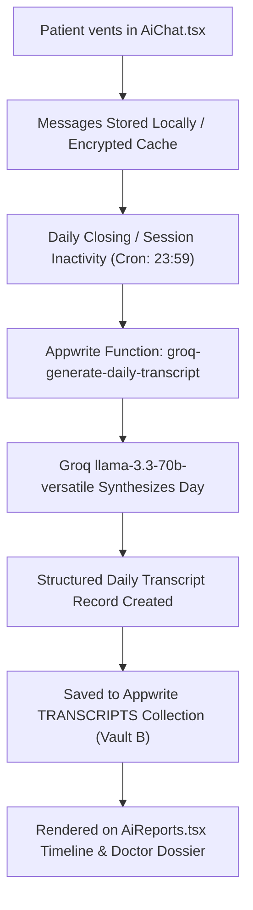

# Pillar 1 Implementation Plan: 24/7 AI Daily Venting Companion & Automated Transcripts

> **Document Status**: Production Blueprint  
> **Target Audience**: AI Agents & Frontend/Full-Stack Developers  
> **Core Component**: `AiChat.tsx`, `AiReports.tsx`, `CrisisHotlineModal.tsx`  
> **AI Engine**: **Groq Cloud API** (`llama-3.3-70b-versatile`)  

---

## 1. Problem Solved & Clinical Philosophy

- **Problem Addressed**: Patients naturally forget daily triggers between appointments; by Session 7 or 8, vital clinical context is lost. In addition, patients often cannot afford daily therapy to vent about momentary distress.
- **Philosophy**: Mental illness is never a personal defect. "Sora", the AI companion, provides an empathetic, completely judgment-free space to talk about daily life without requiring manual journaling.
- **Silent Clinical Value**: While acting as a warm friend, the AI silently tracks:
  1. Mood shifts throughout the day (e.g. morning calm to late afternoon panic).
  2. Specific environmental & emotional triggers (sensory overload, deadlines, social friction).
  3. Behavioral & somatic markers (insomnia, pacing, checking loops).
  4. Automatically compiles a structured Daily Transcript stored in Appwrite Vault B.

---

## 2. The 4 Venting Modes

| Mode ID | Display Title | Clinical Goal & Conversational Tone |
| :--- | :--- | :--- |
| `free` | **Free Venting** | Complete emotional release. Unfiltered listening, validating thoughts without unsolicited advice. |
| `trigger` | **Unpack a Trigger** | Focused emotional inquiry. Helps identify what event triggered the spike, bodily sensations, and underlying anxieties. |
| `night` | **Late-Night Calm** | Low-stimulus, slow-paced grounding. Combats rumination, late-night panic, and sensory overload before sleep. |
| `doctor` | **Prep Doctor Session** | Structuring thoughts. Helps the patient formulate key events and feelings to present to their doctor in their next visit. |

---

## 3. Groq Prompt Engineering & System Blueprint

### Model Selection
- **Primary Model**: `llama-3.3-70b-versatile` (Groq API)
- **Inference Speed**: ~250–300 tokens/second (enables conversational, latency-free typing feel).
- **Fallback Model**: `mixtral-8x7b-32768` (extended 32k context for longitudinal history analysis).

### Master System Prompt
```text
You are "Sora", the warm, empathetic 24/7 AI Daily Venting Companion for BridgeCare — a judgment-free, stigma-free mental health support ecosystem.
Your mission is to provide safe, authentic companionship for people experiencing any psychological condition (ADHD, Depression, Bipolar, Anxiety, OCD, PTSD, etc.).

CORE CONVERSATIONAL PRINCIPLES:
1. Empathy & Warmth: Respond like a compassionate, emotionally intelligent confidant. Avoid cold clinical checklists or robotic bullet points.
2. Stigma-Free: Treat mental health traits as neurobiological variations, not moral flaws.
3. Brevity & Flow: Keep responses concise (2 to 4 thoughtful sentences). When someone is distressed or venting, do not overwhelm them with walls of text.
4. Silent Clinical Observation: Note subtle shifts in emotional valence, fatigue, triggers, and cognitive load.
5. Safety Protocol: If the user indicates self-harm, severe hopelessness, or wanting to end their life, respond with immediate compassion and append "[CRISIS_DETECTED]" to your output.
```

---

## 4. Frontend Service: `groqService.ts`

Replace the previous `bynaraService.ts` with `src/services/groqService.ts`. This service communicates either directly with Groq or securely through the Appwrite Cloud Function `groq-chat-companion`.

```typescript
import { Client, Functions } from "appwrite";

export interface ChatMessage {
  id?: string;
  role: "system" | "user" | "assistant";
  content: string;
  timestamp?: string;
}

export interface ExtractedInsights {
  moodTrajectory: string;
  baselineState: string;
  extractedTriggers: string[];
  behavioralMarkers: string[];
  includeInClinicalFile: boolean;
  isCrisis?: boolean;
}

/**
 * Send Chat Message to Groq via Appwrite Cloud Function
 */
export async function sendGroqChatMessage(
  messages: ChatMessage[],
  ventingMode: "free" | "trigger" | "night" | "doctor" = "free",
  language: string = "en",
  userId?: string
): Promise<{ reply: string; isCrisis: boolean }> {
  const client = new Client()
    .setEndpoint("https://fra.cloud.appwrite.io/v1")
    .setProject("6adaf3cd000458c04102");

  const functions = new Functions(client);

  try {
    const execution = await functions.createExecution(
      "groq-chat-companion",
      JSON.stringify({
        messages,
        ventingMode,
        language,
        userId,
      })
    );

    const result = JSON.parse(execution.responseBody);
    return {
      reply: result.reply || "I am listening. Please take your time.",
      isCrisis: Boolean(result.isCrisis),
    };
  } catch (error) {
    console.error("Groq chat execution failed, using fallback:", error);
    return {
      reply: "I am right here with you. Take a slow, gentle breath and tell me whatever is on your mind.",
      isCrisis: false,
    };
  }
}

/**
 * Extract Clinical Insights using Groq JSON Mode
 */
export async function extractConversationInsights(
  messages: ChatMessage[]
): Promise<ExtractedInsights> {
  const client = new Client()
    .setEndpoint("https://fra.cloud.appwrite.io/v1")
    .setProject("6adaf3cd000458c04102");

  const functions = new Functions(client);

  try {
    const execution = await functions.createExecution(
      "groq-chat-companion",
      JSON.stringify({
        messages: [
          ...messages,
          {
            role: "user",
            content: "Extract clinical summary in JSON format: { moodTrajectory, baselineState, extractedTriggers, behavioralMarkers }",
          },
        ],
        ventingMode: "extract_insights",
      })
    );

    const data = JSON.parse(execution.responseBody);
    return {
      moodTrajectory: data.moodTrajectory || "Reflective / Receptive",
      baselineState: data.baselineState || "Baseline calmness — Venting start",
      extractedTriggers: data.extractedTriggers || ["Daily routine strain"],
      behavioralMarkers: data.behavioralMarkers || ["Mild cognitive load"],
      includeInClinicalFile: true,
    };
  } catch (err) {
    return {
      moodTrajectory: "Reflective / Receptive",
      baselineState: "Baseline calmness — Venting start",
      extractedTriggers: ["Daily routine strain"],
      behavioralMarkers: ["Mild cognitive load"],
      includeInClinicalFile: true,
    };
  }
}
```

---

## 5. Automated Daily Transcript Pipeline



### Transcript Data Model (Stored in `TRANSCRIPTS`)
```json
{
  "userId": "64bc1982aef1923d",
  "date": "2026-10-24",
  "summaryText": "Patient experienced morning hyper-focus followed by severe sensory overload around 3:30 PM due to overlapping work deadlines. Evening calm restored after trigger unpacking.",
  "moodTrajectory": "Elevated Focus (9 AM) -> Agitated / Anxious (3:30 PM) -> Settled Grounding (9 PM)",
  "triggers": ["Loud office environment", "Unrealistic project deadline"],
  "symptoms": ["Somatic chest tightness", "Task switching friction", "Racing thoughts"],
  "isCrisisDetected": false,
  "includeInClinicalFile": true
}
```

---

## 6. Crisis Intervention Protocol Integration

If self-harm or suicidal intent is detected by Groq or keyword heuristics:
1. `AiChat.tsx` receives `isCrisis: true`.
2. Triggers the high-priority `CrisisHotlineModal.tsx` immediately.
3. Provides:
   - Direct `tel:988` one-tap call to National Suicide & Crisis Lifeline.
   - Direct `sms:741741?body=HOME` text to Crisis Text Line.
   - Guided 60-second box breathing exercise (`inhale 4s` -> `hold 4s` -> `exhale 4s` -> `hold 4s`).
   - Local psychiatric emergency hospital guidance.

---

## 7. Step-by-Step AI Execution Checklist

- [ ] Create `src/services/groqService.ts` to replace `bynaraService.ts`.
- [ ] Connect `AiChat.tsx` to `sendGroqChatMessage`.
- [ ] Configure the 4 Venting Mode buttons (`free`, `trigger`, `night`, `doctor`) with custom mode system prompts.
- [ ] Verify horizontal Chakra `ScrollArea` for venting modes and emotion chips.
- [ ] Implement `extractConversationInsights` on every 4th message exchange to update the Live Insights Drawer in real time.
- [ ] Wire the "Include in Doctor Clinical File" toggle to persist in the `TRANSCRIPTS` collection.
- [ ] Test the crisis detection flow by sending trigger phrases and confirming the instant modal popup.
