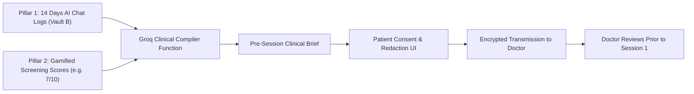

# Pillar 3 Implementation Plan: Therapist Integration, Pre-Session Clinical File & ZEGOCLOUD Telehealth

> **Document Status**: Production Blueprint  
> **Target Audience**: AI Agents & Full-Stack/WebRTC Developers  
> **Core Components**: `TherapistsDirectory.tsx`, `LatestSessions.tsx`, `Billing.tsx`, `zegocloudService.ts`  
> **Video Engine**: **ZEGOCLOUD WebRTC SDK** / UI-Kit  
> **Clinical AI Engine**: **Groq Cloud API** (`llama-3.3-70b-versatile`)  

---

## 1. Clinical & Economic Innovation

In traditional therapy:
- Patients spend **3 to 5 initial sessions** (\$300–\$600) simply narrating their life story, triggers, and past struggles. Many drop out due to financial exhaustion before actual therapy begins.
- By **Session 7 or 8**, patients forget recent daily triggers, while doctors juggle dozens of patients and cannot remember subtle longitudinal patterns.

BridgeCare eliminates this through the **Pre-Session Clinical File**:
1. **Automated Synthesis**: Groq synthesizes 14–30 days of daily venting logs (Pillar 1) + gamified cognitive screening scores (Pillar 2) into a professional psychiatric briefing.
2. **Session 1 Treatment**: The licensed doctor reviews the brief *before* the call begins, allowing active treatment and prescription planning in Session 1.
3. **Session 8 Memory Continuity**: Longitudinal logs remain accessible side-by-side during video calls, so context is never lost.
4. **HD Video Calls via ZEGOCLOUD**: Encrypted, HIPAA/telehealth-grade WebRTC video consultations with zero third-party software installation.

---

## 2. Pre-Session Clinical File Architecture



### Groq Clinical Brief Compilation Prompt
The Appwrite Cloud Function `groq-clinical-brief-compiler` invokes Groq with this structured prompt:
```text
You are a psychiatric clinical decision-support assistant for BridgeCare.
Analyze the following patient data:
- Daily Transcripts: [ARRAY OF SUMMARIES]
- Gamified Scores: Attention: 7/10, Mood: 6/10, Pattern: 3/10

Generate a concise Pre-Session Clinical Brief for a licensed psychiatrist in JSON format:
{
  "executiveSummary": "Synthesized 3-paragraph clinical overview",
  "chiefComplaints": ["Primary recurring distress points"],
  "longitudinalMoodTrajectory": "Summary of emotional swings over past weeks",
  "identifiedTriggers": ["Workplace sensory overload", "Perfectionism checking loops"],
  "symptomMarkers": ["Task switching delay", "Sleep latency > 90 mins"],
  "gameScreeningSynthesis": "Interpretation of 7/10 attention and 6/10 mood scores",
  "suggestedExplorationAreas": ["Differential between ADHD and Anxiety-induced inattention"]
}
```

---

## 3. ZEGOCLOUD Telehealth Video Integration

### Architecture & Credentials
- **Provider**: ZEGOCLOUD WebRTC Video Call Service.
- **Client Library**: `@zegocloud/zego-uikit-prebuilt` (or `@zegocloud/zego-express-engine-webrtc`).
- **Security**: Tokens are never generated on the client. The frontend requests a signed room token from Appwrite Cloud Function `zegocloud-token-generator`.

### Frontend Video Service (`src/services/zegocloudService.ts`)
```typescript
import { ZegoUIKitPrebuilt } from "@zegocloud/zego-uikit-prebuilt";
import { Client, Functions } from "appwrite";

export interface ZegoTokenResponse {
  token: string;
  appId: number;
  roomId: string;
  userId: string;
}

/**
 * Fetch signed ZEGOCLOUD Room Token from Appwrite Cloud Function
 */
export async function getZegoRoomToken(roomId: string, userId: string, role: "patient" | "therapist"): Promise<ZegoTokenResponse> {
  const client = new Client()
    .setEndpoint("https://fra.cloud.appwrite.io/v1")
    .setProject("6adaf3cd000458c04102");

  const functions = new Functions(client);

  const res = await functions.createExecution(
    "zegocloud-token-generator",
    JSON.stringify({ roomId, userId, role })
  );

  return JSON.parse(res.responseBody);
}

/**
 * Initialize and Mount ZEGOCLOUD Consultation Room in DOM Element
 */
export async function initializeZegoConsultation(
  element: HTMLDivElement,
  roomId: string,
  userId: string,
  userName: string,
  role: "patient" | "therapist",
  onLeave?: () => void
) {
  const { token, appId } = await getZegoRoomToken(roomId, userId, role);

  const kitToken = ZegoUIKitPrebuilt.generateKitTokenForProduction(
    appId,
    token,
    roomId,
    userId,
    userName
  );

  const zp = ZegoUIKitPrebuilt.create(kitToken);

  zp.joinRoom({
    container: element,
    scenario: {
      mode: ZegoUIKitPrebuilt.OneONoneCall, // 1-on-1 Doctor-Patient Consultation
    },
    showPreJoinView: true,
    turnOnMicrophoneWhenJoining: true,
    turnOnCameraWhenJoining: true,
    showMyCameraToggleButton: true,
    showMyMicrophoneToggleButton: true,
    showAudioVideoSettingsButton: true,
    showScreenSharingButton: true,
    showTextChat: false, // In-session context is handled by BridgeCare's sidebar
    showUserList: false,
    maxUsers: 2,
    layout: "Auto",
    onLeaveRoom: () => {
      if (onLeave) onLeave();
    },
  });

  return zp;
}
```

---

## 4. Live Consultation Room Layout (`LatestSessions.tsx`)

The consultation room features a split layout to provide instant context:

```
+-----------------------------------------------------------+
| Top Bar: Dr. Sarah Jenkins (Psychiatrist) | 28:42 Remaining|
+------------------------------+----------------------------+
|                              | [SHARED SESSION CONTEXT]   |
|                              |                            |
|       ZEGOCLOUD              | * Past 7 Days Mood Shift:  |
|       HD Video Frame         |   Calm morning -> 3PM panic|
|                              |                            |
|       (Doctor & Patient      | * Top Triggers:            |
|        1-on-1 Consultation)  |   - Deadline overload      |
|                              |   - Sleep latency          |
|                              |                            |
|                              | * Indicative Game Scores:  |
|                              |   - ADHD Indicator: 7/10   |
|                              |   - Mood Indicator: 6/10   |
|                              |                            |
| [Mute] [Camera] [End Call]   | * Doctor Notes & E-Pad     |
+------------------------------+----------------------------+
```

---

## 5. Booking Flow & Financial Savings Meter

In `TherapistsDirectory.tsx` and `Billing.tsx`:
1. **Estimated Savings Badge**:
   > *"By attaching your BridgeCare Ready Doctor File, you bypassed 3 exploratory sessions and saved \$450. Treatment starts in Session 1."*
2. **Session Pricing Transparency**: Flat session fee clearly displayed in local currency.
3. **Doctor Verification Badge**: Verified Medical License number displayed on every card.

---

## 6. Step-by-Step AI Execution Checklist

- [ ] Install ZEGOCLOUD dependencies in `apps/Main`:
  ```bash
  npm install @zegocloud/zego-uikit-prebuilt
  ```
- [ ] Create `src/services/zegocloudService.ts` for token acquisition and room mount.
- [ ] Implement `initializeZegoConsultation` inside the active session view of `LatestSessions.tsx`.
- [ ] Connect the "Shared Session Context" side panel to read real transcripts from Appwrite `TRANSCRIPTS`.
- [ ] Connect `TherapistsDirectory.tsx` to read licensed doctor cards from Appwrite `THERAPISTS`.
- [ ] Wire the appointment booking button to create a record in `SESSIONS` and generate a unique `zegoRoomId`.
- [ ] Implement the Pre-Session Clinical File review modal where patients inspect their summary before final booking.
