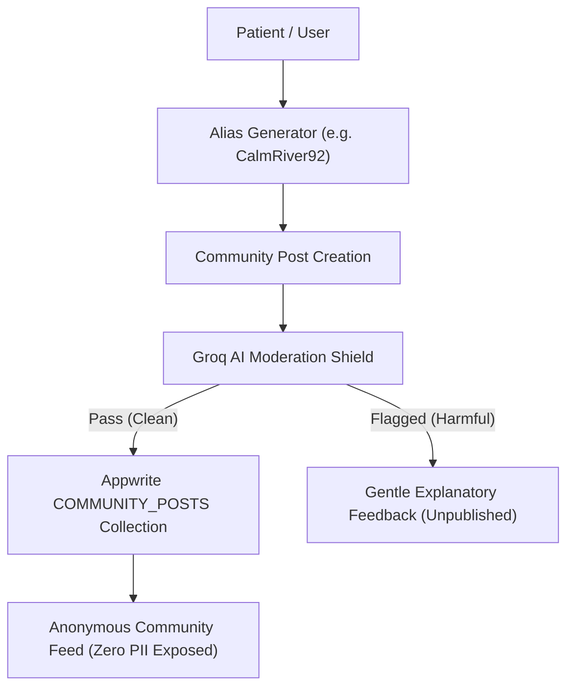

# Pillar 4 Implementation Plan: Safe & Anonymous Peer Community & Groq Moderation

> **Document Status**: Production Blueprint  
> **Target Audience**: AI Agents & Full-Stack Developers  
> **Core Components**: `CommunityPosts.tsx`, `CommunityViral.tsx`, `CommunityNotifications.tsx`  
> **Moderation AI Engine**: **Groq Cloud API** (`llama-3.3-70b-versatile`)  

---

## 1. Vision & Non-Toxic Philosophy

Traditional social media platforms exacerbate mental distress through toxic comparison, cyberbullying, algorithmic rage-bait, and public identity risks. 

BridgeCare builds a **radically safe peer sanctuary**:
1. **100% Pseudonymous**: No legal names, phone numbers, or social handles are ever visible. Users post under auto-generated calming aliases (e.g., `"CalmRiver92"`).
2. **All Psychological Conditions Welcomed**: Inclusive channels covering ADHD, Bipolar, Depression, OCD, Anxiety, PTSD, and undiagnosed questioning individuals.
3. **Real-Time Groq AI Safety Shield**: Automatically screens every post and comment before publication, blocking cyberbullying, harassment, and harmful self-harm encouragement.
4. **Empathetic Reaction Currency**: Zero downvote buttons or superficial popularity counts. Users support each other through 3 intentional affirmations: **Relate**, **Strength**, and **Helpful**.

---

## 2. Pseudonymity & Data Isolation Architecture



- When a patient signs up, their email/phone is stored in **Vault A** (`USERS`).
- Community posts use only `authorAlias` and `authorAvatar` stored in **Vault B** (`COMMUNITY_POSTS`).
- There is **zero foreign key relationship** exposed to the public API linking a community post back to a patient's real contact information.

---

## 3. Condition Spaces & Category Taxonomy

| Space ID | Display Title | Purpose |
| :--- | :--- | :--- |
| `all` | **All Conditions Feed** | Global sanctuary feed for universal mental health support. |
| `adhd` | **ADHD & Focus** | Executive dysfunction, hyper-fixation, sensory overload, and daily focus hacks. |
| `depression` | **Depression & Low Mood** | Anhedonia, fatigue, low-motivation struggles, and gentle survival steps. |
| `bipolar` | **Bipolar Spectrum** | Energy shifts, mania/hypomania management, and emotional stabilization. |
| `anxiety` | **Anxiety & Panic** | Somatic anxiety, panic attacks, social fears, and grounding techniques. |
| `ocd` | **OCD & Intrusive Loops** | Checking loops, symmetry compulsions, intrusive thoughts, and uncertainty acceptance. |
| `ptsd` | **PTSD & Trauma** | Hypervigilance, flashbacks, somatic grounding, and safe peer recovery. |
| `wins` | **Small Daily Wins** | Celebrating micro-victories (e.g., getting out of bed, drinking water, attending Session 1). |

---

## 4. Groq Real-Time Moderation Shield

### Evaluation Criteria
The moderation engine screens every text payload against four non-negotiable criteria:
1. **Self-Harm Encouragement or Lethal Means**: Severe violation. Block immediately and surface the Crisis Hotline modal.
2. **Bullying, Mocking, or Stigmatizing**: Block immediately (e.g., calling symptoms "fake" or using derogatory slurs).
3. **Unlicensed Medical Prescriptions**: Block (e.g., *"Take 100mg of my medication, it cured me"*). Only licensed doctors can prescribe.
4. **Toxic Profanity & Verbal Harassment**: Block immediately.

### Frontend Moderation Hook (`src/services/moderationService.ts`)
```typescript
import { Client, Functions } from "appwrite";

export interface ModerationResult {
  isSafe: boolean;
  flagReason: "clean" | "self_harm" | "bullying" | "medical_advice" | "toxic";
  explanation: string;
  suggestedWarning?: string | null;
}

export async function moderateCommunityContent(content: string, conditionSpace: string): Promise<ModerationResult> {
  const client = new Client()
    .setEndpoint("https://fra.cloud.appwrite.io/v1")
    .setProject("6adaf3cd000458c04102");

  const functions = new Functions(client);

  try {
    const res = await functions.createExecution(
      "groq-community-moderator",
      JSON.stringify({ content, conditionSpace })
    );

    return JSON.parse(res.responseBody);
  } catch (err) {
    console.warn("Moderation fallback applied:", err);
    return {
      isSafe: true,
      flagReason: "clean",
      explanation: "",
    };
  }
}
```

### Compassionate Rejection UI (Non-Punitive Feedback)
If a post is flagged by Groq, `CommunityPosts.tsx` does not issue a punitive ban. Instead, it displays a warm coaching box:
> *"We couldn't post this because it mentions specific medication dosing. In BridgeCare, only licensed doctors can suggest dosages to keep everyone safe. Could you rephrase your post to focus on how you felt instead?"*

---

## 5. Empathetic Reaction System

In `CommunityPosts.tsx`, each post has 3 affirming reaction buttons:

```tsx
<HStack gap="2">
  {/* Relate Button */}
  <Button
    size="xs"
    px="3"
    py="1.5"
    borderRadius="full"
    fontSize="xs"
    variant="subtle"
    colorPalette="orange"
    onClick={() => handleReaction(post.id, "relate")}
  >
    <HStack gap="1.5">
      <LuHeart size={14} />
      <Text>{t("community.relate")} ({post.relateCount})</Text>
    </HStack>
  </Button>

  {/* Sending Strength Button */}
  <Button
    size="xs"
    px="3"
    py="1.5"
    borderRadius="full"
    fontSize="xs"
    variant="subtle"
    colorPalette="purple"
    onClick={() => handleReaction(post.id, "strength")}
  >
    <HStack gap="1.5">
      <LuSparkles size={14} />
      <Text>{t("community.strength")} ({post.strengthCount})</Text>
    </HStack>
  </Button>

  {/* Helpful Perspective Button */}
  <Button
    size="xs"
    px="3"
    py="1.5"
    borderRadius="full"
    fontSize="xs"
    variant="subtle"
    colorPalette="teal"
    onClick={() => handleReaction(post.id, "helpful")}
  >
    <HStack gap="1.5">
      <LuSmile size={14} />
      <Text>{t("community.helpful")} ({post.helpfulCount})</Text>
    </HStack>
  </Button>
</HStack>
```

---

## 6. Step-by-Step AI Execution Checklist

- [ ] Create `src/services/moderationService.ts` to connect to Appwrite `groq-community-moderator`.
- [ ] Connect `CommunityPosts.tsx` to read posts from Appwrite `COMMUNITY_POSTS`.
- [ ] Integrate real-time moderation into the "Share Post" button; prevent submission if `isSafe === false`.
- [ ] Implement live counter increments for `relateCount`, `strengthCount`, and `helpfulCount` with optimistic UI updates.
- [ ] Add the nested comment thread modal in `CommunityPosts.tsx` using `COMMUNITY_COMMENTS`.
- [ ] Connect `CommunityViral.tsx` to query posts sorted by highest reaction volume (`relateCount + strengthCount`).
- [ ] Connect `CommunityNotifications.tsx` to show alerts when peers react to the user's anonymous posts.
